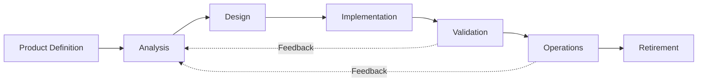

# GRACE Lifecycle Overview

GRACE stands for **Goals, Requirements, Alignment, Constraints, and Execution**. It is a product development methodology that treats software work as a traceable chain from intent to operation. The core idea is simple: every meaningful decision should connect back to a goal, every solution should be justified, and every stage should produce enough clarity to support the next one without pretending certainty that does not exist.

## Simplified Diagram

<em>Simplified GRACE lifecycle with the primary feedback path shown</em>

## What GRACE Optimizes For

GRACE helps teams avoid building the wrong thing efficiently. It emphasizes explicit alignment between business goals, user needs, requirements, design choices, implementation work, and operational reality. It also assumes that later discovery is normal: feedback from validation and operations should regularly send the team back upstream.

## The Seven Stages

### 1. Product Definition

Clarify what initiative is worth pursuing, for whom, and why. The outputs are the audience, intended outcomes, major use cases, initial scope, and rationale for proceeding.

### 2. Analysis

Build the traceability model that connects goals, problems, requirements, solutions, risks, and scope. Analysis is complete when the graph is coherent, causally defensible, and approved before technical design begins.

### 3. Design

Translate the approved analysis into a design package. This usually includes UX design, system design, UI design where relevant, and a testing strategy that explains how correctness will be verified.

### 4. Implementation

Build the solution using disciplined engineering practices. GRACE expects test-driven development, clear acceptance criteria, code review, documented technical debt, and work that traces back to the approved analysis.

### 5. Validation

Confirm that the implemented solution actually achieves the intended goals. Validation is where misunderstandings, missing requirements, and new opportunities become visible and feed back into earlier stages.

### 6. Operations

Run and maintain the product in production. This includes observability, incident response, maintenance, ownership, and change management for bugs and enhancements discovered after release.

### 7. Retirement

End the product deliberately when it no longer justifies continued operation. Retirement includes planning for users, dependents, migration or export, communication, and decommissioning.

## Two Important Scaling Ideas

GRACE scales its rigor in two ways:

- **Project type:** a learning exercise, an internal tool, a product for others, and a commercial offering do not require the same depth of analysis and design.
- **Solution type:** not every solution should be built from scratch. GRACE evaluates options along a spectrum of **Adopt**, **Configure**, **Extend**, and **Build**, preferring the leftmost viable choice.

## Cross-Stage Release Planning

Release planning is orthogonal to the seven stages. It selects the current product-graph slice for near-term delivery, often beginning from a solution but sometimes from requirements, risks, validation findings, defects, or design options. The release plan says what work is in focus now; the stages still govern how that work is analyzed, designed, implemented, validated, operated, or retired.

## Core Working Principles

- Every meaningful piece of work should trace back to a real goal.
- Requirements are living specifications, not one-time tickets.
- Stages are sequential for clarity, but feedback can return to any earlier stage.
- Rigor should match risk, cost of failure, and certainty level.
- Documentation is part of the product, not an optional afterthought.
- Working software is the real test, but alignment should come before confidence.

## Applying GRACE to Changes

The lifecycle also applies to existing systems. Trivial changes can be implemented directly, but small and medium changes should still be checked for alignment. GRACE especially warns against premature solutioning: when someone asks for a specific change, the team should briefly verify the goal, the underlying cause, and whether the change makes the system better or merely patches around a deeper issue.

For an existing product, feature analysis should update the canonical product
graph rather than create a separate feature-local graph. Feature or release
notes may summarize the slice in focus, but existing IDs and traceability should
be preserved unless the product graph is deliberately re-baselined.
